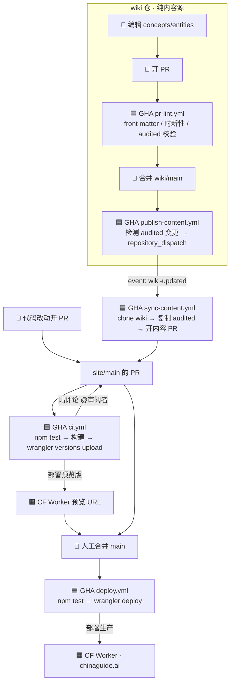

# 发布流水线(CI/CD)说明

> chinaguide.ai 的内容如何从编辑到上线。两个仓库协作:
> **wiki** `chinatrip/foreigner-visiting-china-wiki`(纯内容源)+ **site** `chinatrip/china-travel-site`(本仓,Astro 静态站 → Cloudflare Worker)。

## 一句话心智模型

**GitHub Actions 统筹一切(校验 + 编排 + 调用部署);Cloudflare 只是被推送的部署目标。**
任何东西上线 = 「**一个到 `site/main` 的 PR**,过了 CI、看过预览、被合并」。代码改动和内容改动都收敛到这一条路径。

> 部署是 GitHub Actions 工作流里的**一步**(`wrangler deploy`),所以**全程在 site 仓的 Actions 标签页可见**——不需要去 Cloudflare 后台找。

## 全景图



🟦 = GitHub Actions · 🟧 = Cloudflare(只被动执行部署)· 👤 = 人工

## 谁负责每个阶段

| # | 阶段 | 执行者 | 实现 |
|---|---|---|---|
| 1 | wiki 内容 PR 校验 | 🟦 GHA | wiki `pr-lint.yml`(Python `lint_helper.py`) |
| 2 | 合并 wiki PR | 👤 | 看 lint 绿 → Merge |
| 3 | 检测 audited + 通知 site | 🟦 GHA | wiki `publish-content.yml` → `repository_dispatch` |
| 4 | 同步内容 + 开内容 PR | 🟦 GHA | site `sync-content.yml`(`create-pull-request`) |
| 5 | 代码改动开 PR | 👤 | 主动发起 |
| 6 | PR 校验 | 🟦 GHA | site `ci.yml` → `npm test` |
| 7 | PR 预览部署 | 🟦 GHA → 🟧 CF | `ci.yml` → `wrangler versions upload` → 预览 URL |
| 8 | 合并 site PR | 👤 | 看 CI 绿 + 点预览核对 → Merge |
| 9 | 生产部署 | 🟦 GHA → 🟧 CF | site `deploy.yml`(push main)→ `wrangler deploy` |

**人工只在 3 处**:#2 合并 wiki PR、#5 开代码 PR、#8 合并 site PR。其余全自动。

## 两条流程

### A. 代码改动(改站点本身)
1. 开发者开 PR(#5)。
2. `ci.yml` 跑 `npm test`(node:test + astro build + 内链尾斜杠 guard)并用 `wrangler versions upload` 部署一个**预览版**(#6/#7)。
3. CI 成功后自动在 PR 贴评论:`✅ 可合并 + 预览 URL`,并 @审阅者。
4. 审阅者点预览核对、合并(#8)→ `deploy.yml` 跑 `wrangler deploy` 上生产(#9)。

### B. 内容改动(改 wiki)
1. 作者在 wiki 改 `concepts/`(→ guides)或 `entities/`(→ apps),把 front matter 的 `review.status` 设为 `audited`,开 PR;`pr-lint.yml` 校验(#1)。
2. 合并到 wiki/main(#2)→ `publish-content.yml` 检测到 audited 变更 → 向 site 仓发 `repository_dispatch: wiki-updated`(#3)。
3. site `sync-content.yml` 被触发:克隆 wiki、只复制 `review.status: audited` 的页到 `src/content/`、**开/更新一个内容 PR**(`auto/content-sync` 分支,#4)。多次内容更新累积进同一个 PR。
4. 之后与代码 PR 完全一样:`ci.yml` 跑 gate + 预览(#6/#7)→ 审阅者看 diff + 预览、合并(#8)→ `deploy.yml` 上生产(#9)。

> **审稿要点**:内容 PR 的 diff 要扫一眼有没有**意外删除**或 **front matter 字段被抹掉**(如丢了 `description`/`faqs`)——这通常意味着 wiki 内容漂移,而不是该上线的改动。

## 通知机制(人怎么知道该合并)

GitHub 默认**不会因为 check 变绿就推送你**,所以本流程主动制造通知:
- `ci.yml` 成功 → 在 PR 贴/更新一条 `✅ 可合并 + 预览 URL` 的评论并 **@审阅者** → 触发铃铛/邮件/手机推送,点开就是预览链接。
- `sync-content.yml` 开内容 PR 时 `reviewers:` 请求审阅 → 机器人 PR 不再"隐形"。

> ⚠️ 前提:开内容 PR 用的 PAT(`WIKI_REPO_TOKEN`)**不能是审阅者本人**的账号,否则"请求自己 review / @自己"不会推送。可靠做法是用**机器人账号**的 PAT(作者=机器人,审阅者=人)。

## 在哪观测(全在 GitHub Actions)

| 阶段 | 在哪看 |
|---|---|
| wiki 内容校验 | wiki 仓 **Actions** → `PR Content Lint` |
| wiki 发布触发 | wiki 仓 **Actions** → `publish-content` |
| site 内容同步 / 开 PR | site 仓 **Actions** → `Sync audited wiki content` |
| site PR 校验 + **预览部署** | site 仓 PR **Checks** / **Actions** → `CI & Preview`;预览 URL 见 PR 上 CI 贴的评论 |
| **生产部署** | site 仓 **Actions** → `Deploy (production)`(✅ = 已上生产) |
| 线上 | https://chinaguide.ai |

## Secrets / Token

| Token | 在哪 | 用途 |
|---|---|---|
| `CLOUDFLARE_API_TOKEN` | site | `wrangler deploy` / `versions upload`(用 CF "Edit Cloudflare Workers" 模板) |
| `CLOUDFLARE_ACCOUNT_ID` | site | 指定 Cloudflare 账户 |
| `WIKI_REPO_TOKEN` | site | clone 私有 wiki + 开内容 PR(**须 PAT**) |
| `SITE_REPO_TOKEN` | wiki | 向 site 发 `repository_dispatch` |

> Cloudflare 端只配了 token 接收部署,**关闭了原生 Git 集成**(不再自治构建)——部署由 GitHub Actions 显式发起。

## 常用操作

**手动触发一次内容发布**:site 仓 Actions → `Sync audited wiki content` → Run workflow(或在 wiki 合并一个 audited 改动)。

**看某个 PR 的预览**:打开该 PR → 看 CI 贴的评论里的 `pr-<号>-china-travel-site.<subdomain>.workers.dev` 链接。

**回滚生产**:
- 快:`wrangler rollback`(回到上一个版本),或 `wrangler versions deploy <旧版本ID>` 指定回退。
- 或:`git revert` 那次合并 → push main → `deploy.yml` 自动重新部署上一个状态。
- 或:site 仓 Actions → `Deploy (production)` → Run workflow 手动重发。

## 本地开发

```bash
npm install
npm run sync-content   # 从 wiki 拉 audited 内容到 src/content/(本地走 SSH)
npm run dev            # 本地预览
npm test               # node:test + 构建 + 内链 guard
```
